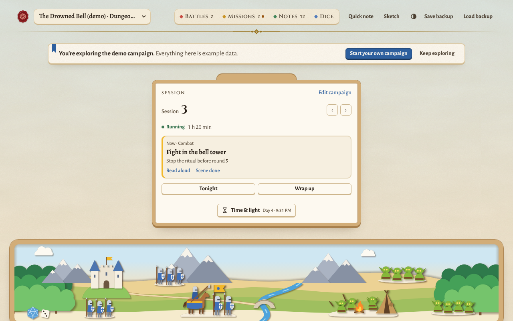
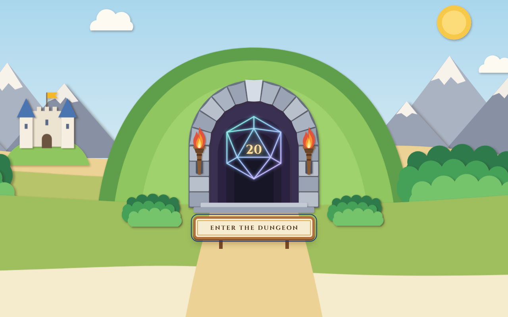
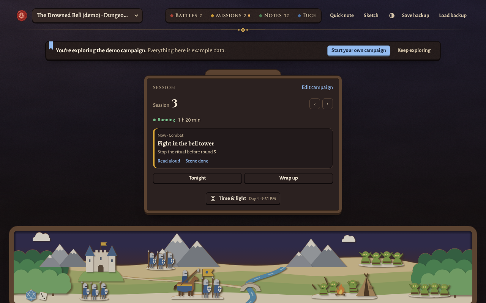
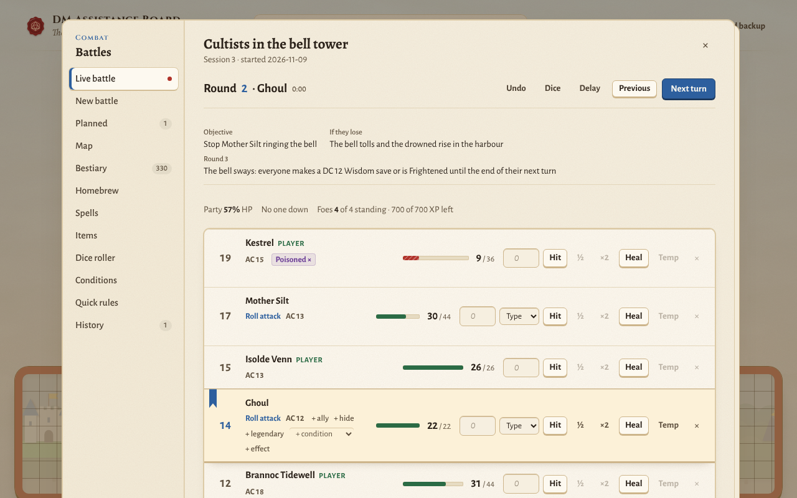
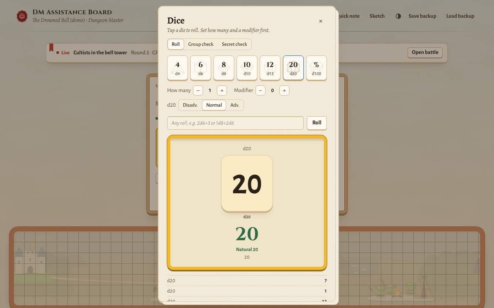
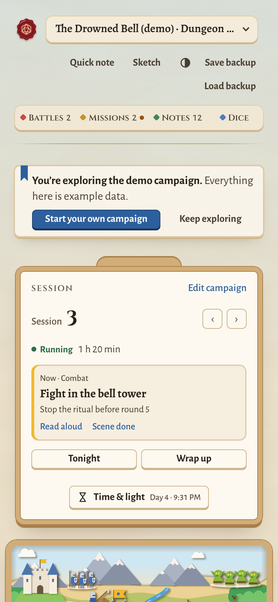

# DM Assistance Board

A Dungeon Master's screen that lives in one web page. DM Assistance Board keeps the party, the live battle, dice, a 5e (2024 rules) bestiary, missions, notes, and in-game time and light together on one paper-cut storybook board. You can run a whole session from it without switching tabs. It is a static site (`index.html` plus plain CSS and JavaScript files) with no build step, no accounts and no server. Your campaign stays in your own browser.

**[Try it live →](https://d00d123.github.io/Dungeon-Master-Assistant/)**



## Features

- **Party at a glance.** HP, AC, conditions, death saves, concentration, passive scores and inspiration for every player.
- **Battles.**
  - Initiative order with turn and round tracking.
  - Damage, healing and temp HP, including resistance and vulnerability (½ and ×2).
  - Conditions and effects that count down automatically.
  - Monster attack rolls, legendary actions, delay, undo and a battle history.
  - Plan encounters ahead of time and see XP budgets.
- **Bestiary.** 330 monsters from the SRD 5.2.1, searchable, with stat cards that roll attacks. You can add your own homebrew monsters.
- **Rules reference.** SRD spells, magic items, conditions and quick rules.
- **Dice.**
  - Slot-machine dice reels and any-notation rolls (`2d6+3`, `1d8+2d6`).
  - Advantage and disadvantage, group checks and secret checks.
- **Story tools.**
  - Missions with clues.
  - Scenes with read-aloud text, NPCs, places, secrets and rumours.
  - Factions, clocks and fronts, handouts, loot, generators and a timeline.
- **Time & light.** An in-game clock and calendar, travel, short and long rests, weather, torches and lanterns, and a dungeon-turn counter.
- **More than one campaign**, each stored separately, plus an experimental D&D Beyond character import.
- **Data safety.**
  - A damaged or cut-short save is never overwritten: the board keeps a copy aside, stops saving and offers a choice of recovery (last good copy, a restore point, your backup file, a file you load, or start fresh).
  - Restore points, a last good copy and undo that survives a reload (you can turn that off on a shared computer).
  - Optional automatic backup to a file you pick (for example in iCloud Drive or Dropbox), a backup reminder you can tune or turn off, and a save-status line in the footer.
  - Clear warnings when browser storage is full or blocked, with a one-click backup.
- **Paper-cut look, light and dark.** Paper panels, cut-paper edges and a static storybook diorama for the table. The theme follows the device setting or your choice. A short animated entry screen, with small effects for crits, big hits and turns that you can turn off. Reduced motion is respected.
- **Light on your device.** Effects are off by default on phones, tablets and low-power computers (you can turn them on). In headless Chromium on a desktop with Effects on, an idle board now uses about 0.1 % CPU during a battle (previously 9–19 %) and about 4 % with the campfire flickering between battles (previously 97 %); start-up style work dropped from about 370 ms to 120 ms. Large reference data loads only when you first need it.
- **Works on a phone or tablet.** The layout adapts down to 360 px wide.

| Entry | Home (dark) |
|---|---|
|  |  |
| **Live battle** | **Dice roll** |
|  |  |



## How to run

- **Locally:** download or clone the repo and open `index.html` in a current browser (Chrome, Edge, Firefox or Safari). Keep the `css/`, `js/`, `data/` and `fonts/` folders next to `index.html`.
- **GitHub Pages:**
  1. Go to *Settings → Pages → Deploy from a branch*.
  2. Choose `main` and `/ (root)`.
  3. The board is then served at `https://<user>.github.io/<repo>/`.

No install, build or dependencies.

A demo campaign, *The Drowned Bell*, loads the first time you open the board. Use **Clear example data** to start with an empty board.

## Your data and privacy

- **Everything is saved in your browser** (localStorage, plus sessionStorage and IndexedDB). Nothing is uploaded, and each visitor's board is their own. Clearing site data erases the board, so keep backups.
- **Save backup** downloads your campaign as a `.json` file. It also copies the same JSON to the clipboard. **Load backup** restores a file. Backups are validated and sanitised when loaded; a backup that is partly damaged asks before loading what can be read.
- **Campaign → Data** shows restore points, the backup file, reminders, undo history and any damaged copies kept aside.
- **Network.** There are no analytics, trackers, CDNs or web fonts from third parties: the fonts are bundled in `fonts/`. The only network request the board can make is the **experimental D&D Beyond character import**, and only when you click **Try fetching it for me**: it fetches that character's public JSON from `character-service.dndbeyond.com`.
  - The default path makes no request from the board: it opens the character data link in your browser, and you paste the JSON or choose a `.json` file.
  - That endpoint is unofficial and may stop working or be blocked by the browser.
- **Content-Security-Policy.** A CSP in the page limits scripts, styles and fonts to the app's own files. Network connections are allowed only to that one import host.

## Keyboard shortcuts

| Key | Action |
|---|---|
| `N` / `P` | Next / previous turn (live battle) |
| `D` | Dice |
| `J` | Quick note |
| `S` | Sketch |
| `Ctrl`+`Z` | Undo the last change |
| `?` | Help: all keys and where everything is |
| `Esc` | Close the open sheet or popup (skips the entry screen) |

## Credits and attribution

This work includes material from the System Reference Document 5.2.1 (“SRD 5.2.1”) by Wizards of the Coast LLC, available at https://www.dndbeyond.com/srd. The SRD 5.2.1 is licensed under the Creative Commons Attribution 4.0 International License, available at https://creativecommons.org/licenses/by/4.0/legalcode.

The monster statistics, spells, magic items and conditions come from the SRD 5.2.1:
- Spell, item and condition summaries are shortened and reworded.
- Monster entries are cut down to numbers and attacks.

**Unofficial fan content.** DM Assistance Board is not approved, endorsed, sponsored by or affiliated with Wizards of the Coast. Dungeons & Dragons, D&D and D&D Beyond are trademarks of Wizards of the Coast LLC.

**Fonts.** The bundled fonts are licensed under the SIL Open Font License 1.1 (see `fonts/OFL-*.txt`):
- [Alegreya](https://github.com/huertatipografica/Alegreya) and [Alegreya Sans](https://github.com/huertatipografica/Alegreya-Sans) by Huerta Tipográfica.
- [Cinzel](https://github.com/NDISCOVER/Cinzel) by Natanael Gama.

The illustrations (entry screen, table diorama, dice faces, icons) are original inline SVG made for this project.

See [NOTICE.md](NOTICE.md) for the full third-party notices.

## Project structure

```
index.html     the page shell (markup, CSP, stylesheet and script tags)
css/           base, intro, components, table, dice, effects, time-light (cascade order)
js/            storage-shim, theme, effects, lazy-data, app, motion, table-ui, backup
data/          rules and demo (start-up); bestiary, spells, items (loaded on first use)
fonts/         bundled WOFF2 fonts and their licences
tests/         Playwright test scripts (development only, not needed to run the board)
docs/          ARCHITECTURE.md and the screenshots
```

[docs/ARCHITECTURE.md](docs/ARCHITECTURE.md) has the module map, load order, storage keys, data flow, data safety and how the effects hook in.

## Running the tests

The board itself needs nothing installed. The tests are development tooling: Node 18+, `npm install` once (ESLint, Prettier), and Playwright with Chromium already available.

```
npm test                    # smoke test: core features, no console errors, CSP, no horizontal scroll
npm run test:visual         # 13 key screens against tests/baseline/
node tests/data-safety.js   # recovery, quota, reminders, undo after reload, backup file
node tests/perf.js          # start-up, idle CPU, frame rate, Effects default
npm run lint && npm run format:check
```

See [tests/README.md](tests/README.md) for the screen sweep and the other scripts.

## Built with

- Plain HTML, CSS and JavaScript with no frameworks, runtime dependencies or build step.
- **Security.** User input is escaped before rendering, backups are validated, and image data URIs are allow-listed. A meta CSP blocks connections to anything but the import host.
- **AI assistance.** This project was designed and directed by me and tested at my own table. It was built with AI assistance: much of the code was written by Anthropic's Claude from my specs and feedback, then reviewed and iterated on.

## License

The code is released under the [MIT License](LICENSE).

The MIT license does **not** cover third-party content:
- **SRD 5.2.1 material** (monster data, spells, magic items, conditions) is CC-BY-4.0, Wizards of the Coast LLC.
- **The fonts** are under the SIL OFL 1.1.

See [NOTICE.md](NOTICE.md).
